# 強制出席型スタディルーム

## 個人学習と招待制のチーム勉強部屋

最初は **My study（내 공부）** が開きます。`팀 공부`から登録済みアカウント最大**6人**の部屋を作成・参加でき、所属は1アカウント1チームです。`설정 → 계정`で公開`名前#識別子`タグを設定すると、友人が完全一致のタグで招待できます。リーダーは撤回可能な7日間の招待リンクも発行できます。リンクを開くだけでは参加せず、ログインして確認・承認します。公開チーム検索、ゲスト、チャット、映像・音声共有はありません。

通常の個人学習を開始・再開すると、参加時のチェックポイント以降の認定区間がチームへ自動加算されます。手動接続は不要で、既存のカメラ・回復・タスク・lease検証を維持します。チーム目標は保存時に共有し、現在のタスク名は共有を選んだ場合だけ表示します。机には学習・休憩・準備状態を示し、個人の全履歴は公開しません。`오늘 공부 종료`は個人学習と振り返りのみを終了し、所属・目標・森を維持します。`팀 탈퇴`の確認画面では、リーダーは後任への委任または明示的な解散を選びます。

`함께 집중`は無制限または**1〜1,440分の直接入力**と25/50分のショートカットに対応します。終了時は通知だけで個人学習を停止せず、無制限でも個人leaseは有効です。`팀 숲`では確定した認定時間120分ごとに木が育ちます。進行中のセッションは精算待ちで、休憩・カメラ除外・参加前・lease満了後は加算しません。累積の森は週/月でリセットせず、個人ランキングもありません。[チームの仕様](memory-bank/prd-social-study-room.md)。

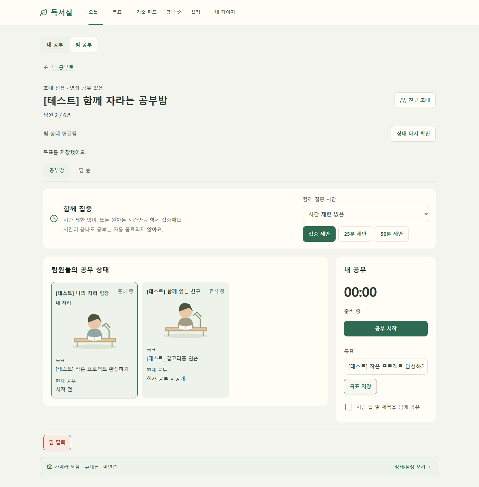

個人学習の操作とチーム所属管理を分離します。375pxでは同じ実装の個人操作がメンバーの机より上に並びます。

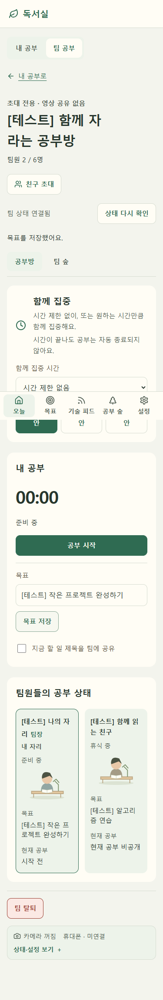

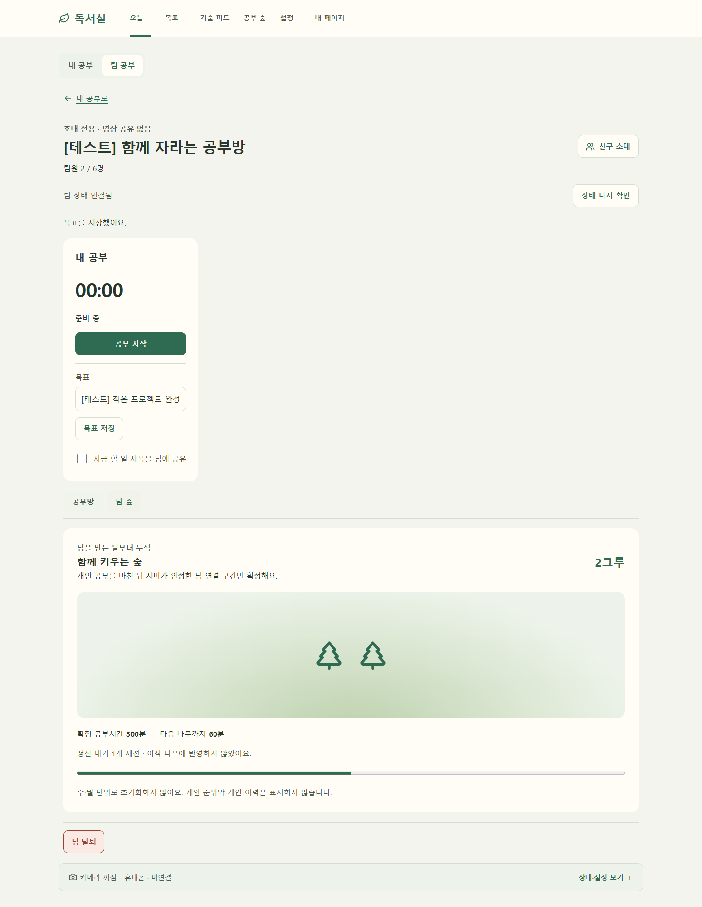

### 開始前に既存タスクの時刻を編集

セッション準備画面の`시간 편집`で開始・終了の数字を直接入力するか時計選択を使い、`시간 저장`で保存、`취소`で下書きを破棄します。日付をまたぐ範囲は使用でき、同一の開始・終了時刻は拒否します。変更するのは**その日付の発生分の時刻だけ**で、名前・繰り返し・選択・保存済み学習は維持します。不要なタスクは`삭제`で削除し、同じ行の時刻保存と削除は同時に実行できません。[時刻編集と受け入れ記録](docs/session-todo-time-edit/verification-20261024.md)。

保存と結果確認にはそれぞれ15秒の期限があります。応答を失った場合は所有タスクを読み直し、保存値が一致すれば追加書き込みなしで完了、別の保存値を確認できれば下書きを維持して`다시 저장`を表示します。結果不明時の`다시 확인`は読み取りだけです。確認中は取消・閉じる操作ができ、同じページ/アカウントで開き直しても未確認の下書きを保持します。取消はサーバーに保存済みの変更を元に戻しません。[無応答の復旧と検証](docs/session-todo-time-edit/timeout-recovery-20261025.md)。

| PCの時刻編集 | モバイルブラウザーの時刻編集 |
| --- | --- |
| 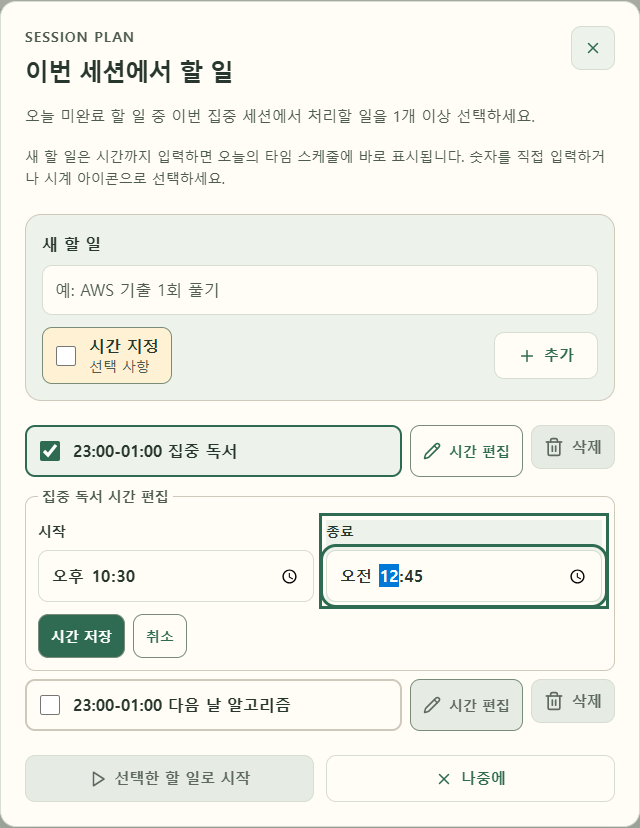 | 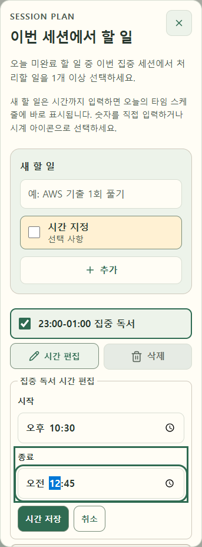 |

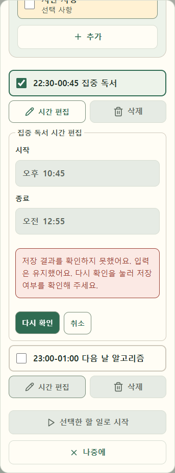

画像は**2026-10-25**、実際の`main.tsx`/`TeamStudySection`を既存mountedテスト境界と**ローカル合成データ**で実行して撮影しました。名前・森の合計はテスト値で、実アカウント2人の受け入れ証拠ではありません。本番学習・通知・外部AI呼び出しは作成していません。[再現と検証](docs/readme-update-20261025.md)。

### PCとAndroidで同じ学習を続ける

インストール型Androidアプリは、ネイティブ権限・設定と認証済みhosted Web画面を使います。同じアカウントで学習、休憩/再開、完了タスクとサーバーleaseを共有します。カメラ担当は1台のみで、観察側は別のカメラや警告・自動終了を起動しません。映像は端末内に留まり、同期しません。明示的な担当変更はタブ移動と別の操作です。

選択画面のコード読込に失敗してもその領域で復旧し、今日へ戻れます。明示リロードは待機中のみで、学習・休憩・保存中はブロックし、必須の終了振り返りを維持します。Android HOME/COLD再起動と短い待機中切断、基本PC↔アプリの開始・休憩・双方向再開・終了・完了同期には受け入れ記録があります。**明示カメラ移譲、Androidを新規担当とする開始、アクティブ学習の長時間バックグラウンド/オフライン、実携帯OEM/DND、通常姿勢の検出、登録済み2アカウントのチーム受け入れは別確認です。** この撮影では証明しません。[同一アカウント検証](docs/cross-device-study/labeled-acceptance-20261019.md) · [Android lifecycle](docs/cross-device-study/mobile-lifecycle-20261019.md) · [画面復旧](docs/safe-section-recovery-20261019.md)。

## StudyRoom 2.0 — 興味から届く技術フィード

### AI要約エラーと再試行

OpenRouterの一時的なエラー（502など）、呼び出し制限、タイムアウト、不正な応答、設定の問題を区別します。すぐに失敗した502/503/504のみ、合計30秒以内に最大1回自動再試行します。失敗が続けば、サーバーの待機時間後に`요약 다시 시도`を選べます（通常60秒、レート制限120秒）。設定の問題では状態を再確認します。表示だけではAIを呼び出さず、統計と原文は引き続き読めます。

無料限定を維持します。OpenRouterの`OPENROUTER_MODEL`に`openrouter/free`または指定`:free`モデルを設定し、無料プロバイダー限定・有料切り替え禁止を適用します。空のモデル設定はクライアントを無効化します。フィードは2,048出力トークン・試行ごと20秒、共有予算は1日15予約（ワーカー最大12）。失敗予約は返却し、実試行40回の上限は返却しません。再試行も予約し、キャッシュはAIを呼び出しません。[復旧と検証](docs/tech-feed/ai-retry.md)。

2026-10-10の検証例：合成入力による実APIテストが1回で正常なブリーフィングを返し、設定・応答モデルは`google/gemma-4-26b-a4b-it:free`でした。CIの確認結果で、固定の本番モデルや品質保証ではありません。無料モデル・ルーターは環境変数で指定します。

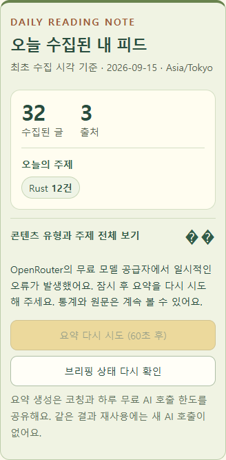

実際のReact画面をテストデータと模擬エラーで撮影しました。実サービスの障害や生成成功の証拠ではありません。


収集設定と閲覧フィルターを分けます。自由入力の興味は**何を収集するか**、折りたたみ式のトピック・配信元フィルターは**収集済みの何を見るか**を決めます。最新・保存の両方で現在のページだけでなく全対象記事から選択肢を作り、長い興味の文の代わりに本文に根拠のある短いタグを表示します。

AI分類を優先し、ない場合は明確な根拠がある記事だけを技術ニュース・実務チュートリアル・事例と深掘りに補完分類します。無理な分類や未分類ラベルの反復は避けます。紹介・翻訳・AI要約のプレビューと展開本文では、文章内の独立したMarkdown見出し記号を取り除き、コード、C#、ハッシュタグと原文リンクを保持します。展開時は見出し・リスト・コードを安全に表示します。外部HTMLは実行しません。

`오늘 수집된 내 피드`はプロフィールのタイムゾーンと記事の初回収集時刻で1日全体を自動集計します。公開日・現在のページ・フィルターとは独立しています。AIインサイトはボタン操作時だけ、権限を確認した最大24件の紹介を分析し、原文への根拠リンクを示します。十分な紹介が最低2件必要で、動画の内容は分析しません。キャッシュを再利用し、新着時は更新が必要と表示、アクセス権を失った結果は非表示にします。現在の共有予算は1日15予約（ワーカー最大12）、失敗予約の返却と実試行40回の上限を適用し、有料には切り替えません。[設計と制限](docs/tech-feed/daily-briefing-design.md) · [反映状況](memory-bank/progress.md)。

原文が提供するサムネイルをカード内に表示し、図を切り取らず比率を保ちます。添付YouTube/Vimeo動画はクリック後に読み込み、自動再生せず閉じられます。画像なし・アクセス制限・失敗時も本文と出典リンクを保持します。過去の記事も手動・定期処理ごとに最大3件ずつ共有キャッシュへ反映するため、全記事のメディアは保証しません。無関係な画像検索・全文保存・追加AI/有料APIは利用しません。

特定の企業やツールに限定せず、**ユーザーが設定した技術への興味に沿う技術ブログ・実務事例・解説・活用ガイド**を探します。AWSやClaude Codeは例にすぎません。同じ検索1回の予算で意図を順番に切り替え、過去1年まで検索します。新規検索の動画・一覧ページや明確な宣伝・チャプター表を除き、読みやすい韓国語Webフォント、大きな本文、タイトルと紹介横の出典リンクを提供します。紹介のみを翻訳し、全文は原文サイトで読みます。


Webで公開技術への興味を入力し、受信・変更・一時停止できます。一般ユーザーの検索APIキーやSNS連携は不要です。新技術の発見 → 韓国語要約または配信元・検索結果の紹介 → 原文 → 学習タスクへつなげます。最新/保存・フィルターと20件単位のページ切替（前後・訪問済みページ番号）を提供します。Threads風の1列フィードで配信元・トピック・韓国語の紹介を読み、長文・AI要約・原文を展開できます。興味や収集元の設定は折りたたみパネルにまとめます。開始画面は引き続き「今日」、設定・保存・タスクの関連付けはユーザー別にサーバーへ保存します。

出席処理とは独立したワーカーが、承認済みRSS/Atom/Hacker Newsと公開Web検索を処理します。正規化後に同一の検索文は1時間キャッシュを共有します。検索はアプリ全体で月最大900回の試行に制限し、毎回無料プランと残量を確認して有料サービスへ切り替えません。検索枠を使い切っても承認済みの有効なRSS/API収集は継続します。AIは実際の抜粋・検索紹介のみを使い、共有予算1日15予約（ワーカー最大12）を使い、失敗予約を返却し、実試行40回の上限を維持します。根拠不足なら紹介と原文リンクを表示します。
`새 글 확인`を押すと、前の確認が完了した直後でもすぐに収集します。実行中の処理は共有しますが5分待ちはありません。定期収集は1時間基準で、複数の興味は1回に1つずつ順番に検索します。既存の無料枠内で検索1回と最大4つの対象RSS/APIを確認し、新着記事や即時AI要約は保証しません。


タイトルと紹介はDeepLの無料APIで韓国語に翻訳し、AI要約・コーチングの共有日次予算とは分離します。サーバー専用`DEEPL_API_PLAN`の既定値は`free`（月50万文字）で、無料プランを確認して`developer`を明示すると利用期間全体100万文字を認めます。Developerの上限は毎月リセットされません。アプリ共通のUTC月45万文字上限と提供元の残量を両方確認し、有料には切り替えません。成功した翻訳を共有し、原文は折りたたみ表示で確認できます。キー未登録・上限・一時停止・失敗時は原文と状態を表示します。無料キーの登録は運営者のみ必要です。[翻訳設定・検証](docs/tech-feed/korean-translation.md)。

対象は検索サービスに索引された公開情報であり、全ページや非公開SNSではありません。検索紹介とAI要約は区別します。推奨RSS/API8ソースは**利用条件の確認待ち**で始まり、公開HTTPSフィードの追加はプレビュー後に最大10件までです。検索に出た配信元のRSS再利用権を自動承認しません。

**ユーザー設定と運用開始は別です。** アプリ運営者が専用の無料検索キー、従量課金無効化、ワーカー設定と実際の収集を確認します。キー未登録・上限到達時は検索を止め、架空のニュースは作りません。[現在の反映状況](memory-bank/progress.md) · [Web検索の運用案内](docs/tech-feed/search-provider.md) · [要件](memory-bank/prd-tech-feed.md) · [キャリア機能の復元](archive/career-coach/README.md)。タイムゾーン設定と学習再開コーチングは維持します。

[English](README.md) | [한국어](README.ko.md) | [日本語](README.ja.md)

決めた時刻に学習を始める約束を、計画・集中・振り返り・改善・報酬へつなげる個人向け学習習慣プロダクトです。

[本番アプリを開く](https://study-room-attendance.vercel.app/) · [本番デプロイ workflow](https://github.com/zxcc9867/studyRoom/actions)

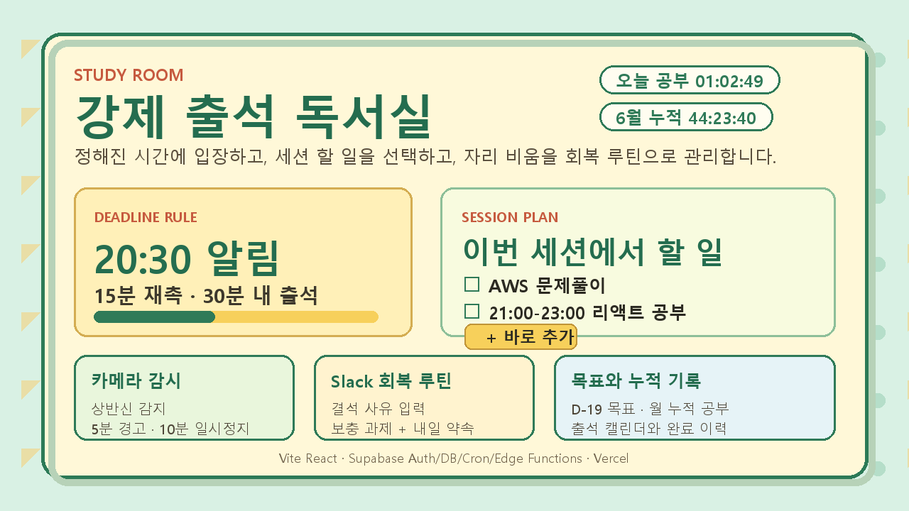

> READMEは現在のユーザー体験と運用モデルを要約しています。詳細な要件、設計判断、進捗は[メモリーバンク](memory-bank/)で管理します。

## このプロジェクトの目的

学習計画を立てることより、毎日実際に始めることのほうが難しい場合があります。このプロダクトは設定した出席時刻に適度な強制力を与え、欠席を罰として扱わずに学習セッション全体を支援します。

Vite/ReactのWebアプリ、Expoモバイル、Supabase Auth/Postgres/RPC/Realtime、予約通知、Three.jsの報酬空間を統合しています。

## 基本的な利用フロー

1. 保存済みSupabaseセッションを復元し、必要に応じてメールOTPまたはGoogle OAuthでログインします。
2. 日付別todo、時間計画、繰り返し予定、目標、D-dayを設定します。
3. Web Push、Slack、メールfallbackで設定時刻のリマインダーを受け取ります。
4. 当日の未完了todoを1件以上選択してセッションを開始します。
5. セッションは1時間のleaseで始まり、1時間単位で延長できます。現在時刻からの残り時間は最大2時間です。
6. 休憩時間を学習時間から除外し、10・20・40分後の復帰予定を設定できます。
7. Webでは上半身の在席をブラウザ内だけで判定します。写真、動画、顔特徴、姿勢ランドマークの原本は保存しません。
8. 終了時に集中度、エネルギー、妨げ、メモ、完了todo、次の行動を振り返ります。
9. 直近7日間の未振り返りセッションを後から整理し、最新の次の行動を次回計画へつなげます。
10. 10分の開始、日次目標、5/7の柔軟なリズム、非懲罰的な再開サインで習慣を育てます。
11. マイページで現在・過去の週/月の学習レポートを比較し、繰り返す妨げに対する具体的な環境調整案を確認します。
12. 出席と継続的な開始を、Study Forestの木、家具、屋外報酬、種の光、蛍のガーランドへ変換します。

## セッションleaseポリシー

- 開始時の基本leaseは1時間です。
- 1回の操作で1時間延長します。
- 現在時刻からの残り時間は最大2時間です。
- WebとSlackは同じサーバーRPCを使用します。
- 満了5分前にSlack警告を送信します。
- Webは15秒ごとにサーバーの締切時刻を同期します。
- ブラウザが閉じていてもSupabase Cronが満了セッションを終了します。
- lease満了後の時間は学習時間として保存されません。

## 主な機能

### 計画と学習セッション

- 日付別・繰り返しtodo、日付をまたぐ予定、月次完了履歴、目標連携。
- 重複時間を表示する円形デイリープランナー。
- サーバーで原子的に処理する開始・休憩・再開・延長・終了。
- 休憩時間の除外と任意の復帰予定。
- WebとExpoで同じセッション・todoルールを共有。

### 継続学習ループ

- セッション振り返りと直近の振り返りインボックス。
- 平日・週末の大きな目標の前に置く10分チェックポイント。
- 最新の振り返りに次の行動があれば、同じタイトルの今日の未完了todoを事前選択。新しい振り返りが空なら古い行動を復活させません。Webのセッション計画では新しいtodoの入力欄を常に空の状態で開きます。
- 休み・10分開始・目標・花を示す直近7日間のリズム。
- 2日の休息余白を持つ5/7目標。
- 過去期間も選べる週次・月次レポート、比較期間の明示、月別の日平均。
- 保存済みアカウントのタイムゾーンで完了セッションを集計。読み込み/エラーを0分として表示せず、再試行できます。
- 次の行動の計画化、繰り返す妨げへの対策、適応型リマインダー候補を維持。
- レポートは保存記録から再計算します。自動配信や固定スナップショットではありません。[要件](memory-bank/prd-study-reports.md)。

### Study Forest

- 家、川、橋、庭、照明、時間帯表現を持つThree.js低ポリゴン島。
- キーボード、タッチ、クリック移動、自動散歩。
- 出席連続日数の木とマイルストーン報酬。
- 島テーマ、家のアクセント、代表報酬のユーザー設定。
- 完了セッションから再計算される種の光と蛍のガーランド。

#### 実際に歩けて、育っていく習慣空間

<p align="center">
  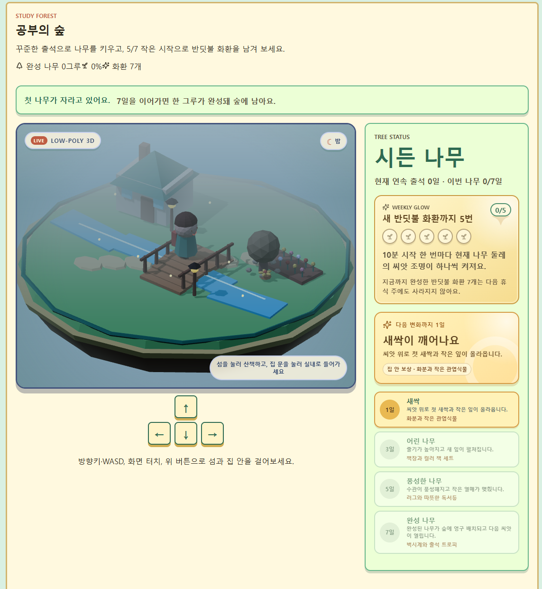
</p>

Study Forestは単なる出席バッジではありません。アバターが島を歩き、水を通り抜けない橋を渡り、家の中に入って学習空間を歩けます。出席と小さな開始が積み重なるほど、島も変化します。

| 生きた島を歩く | 自分の学習コテージへ入る |
| --- | --- |
| 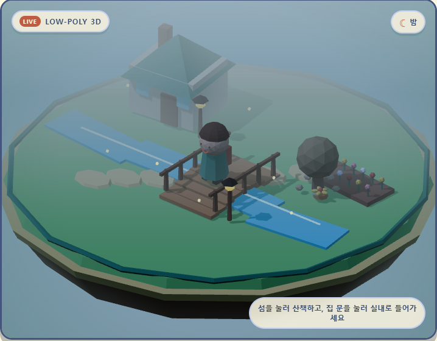 | 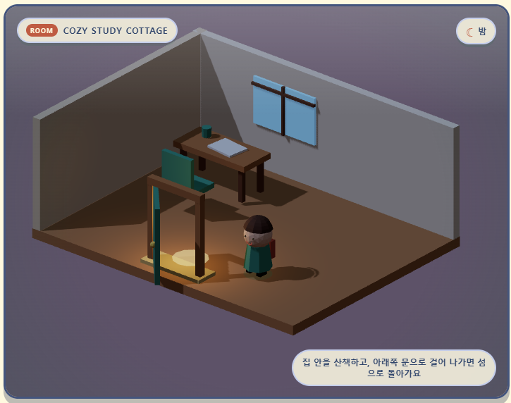 |
| **意図どおりに移動。** キーボード、タッチ、クリック、自動散歩はいずれも陸地と橋の歩行可能な経路に従います。 | **報酬が残る場所。** 実際の扉から入り、家具のある室内を歩き、下側の出口から島へ戻れます。 |

**成長は島に残ります。** 5/7の小さな開始は木の周りの種の明かりを灯し、7日連続出席で木が完成します。完成した木の数に応じて、新しい家具と屋外報酬が解放されます。

<p align="center">
  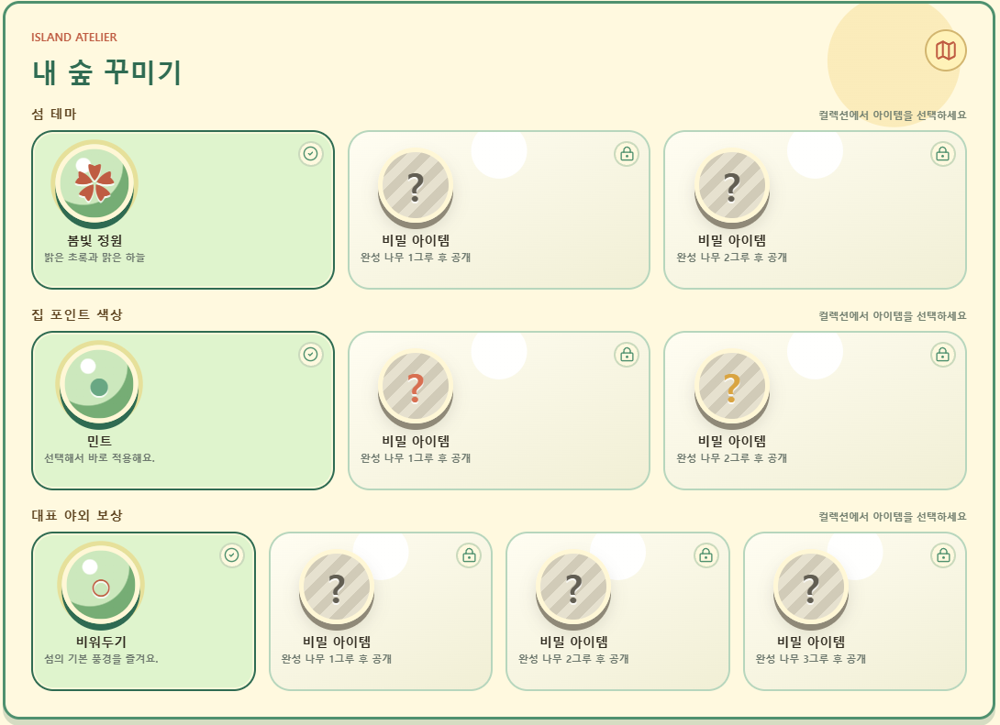
</p>
### 出席・在席・回復

- 平日・週末目標と遅い時間の学習による出席回復。
- 5分警告と10分後の学習時間停止を行うブラウザ内在席判定。
- 欠席または繰り返し離席に対する回復リクエスト。
- 累積欠席は全デバイスで一つの回復ルーティンに集約し、対象期間・日数を表示。補習タスクはユーザーの現地の今日に作成します。
- 週次回復サマリーと原因分類。

### 通知と診断

- Web Push、Slack Bot、Resendメールfallback。
- すでに出席済みでも設定時刻の初回通知を1回送信し、その状態では再通知や欠席への降格を行いません。
- 重複を防ぐ通知claimと配信履歴。
- Slackテスト通知、lease警告、todo時刻通知、回復アクション。
- Supabase CronとEdge Functionによるサーバー側スケジュール。

## 最新ワークフローの補足

- Web の Today 画面は「集中・計画・記録」に分かれ、タイマー、今日の予定、最近の習慣と履歴を短い導線で確認できます。
- Web の学習開始モーダルでは、タイトルと開始・終了時刻を含む todo を追加でき、円形スケジュールと今回のセッション選択に即時反映されます。
- Android hosted画面も同じ時間入力を使います。Webを開けない場合のネイティブExpo代替画面のクイック追加はタイトル入力のみです。
- セッションは1時間の lease で開始し、1回につき1時間延長できますが、現在時刻からの残り時間は最大2時間です。
- 認証済みAndroid hosted画面は単一カメラ担当ポリシーを使います。ネイティブ権限とAndroid新規担当開始・明示移譲・実携帯の背景/DND確認は基本状態同期と区別します。
## アーキテクチャ

```text
apps/web          Vite + ReactダッシュボードとThree.js Study Forest
apps/mobile       Expo React Nativeクライアント
packages/core     出席、日付、OTP、通知、migrationテスト
supabase          Postgres migration、RLS、RPC、Cron、Edge Functions
infra/aws-cdk     任意のS3/CloudFront/EventBridge/Lambda構成
memory-bank       要件、設計判断、進捗、トラブルシューティング
```

- WebはVercel上の静的Viteアプリとして配信します。
- 両クライアントは同じSupabaseプロジェクトとRPC契約を利用します。
- Postgres RLSと明示的な実行権限でユーザーデータを分離します。
- Supabase Cronが毎分attendance Edge Functionを呼び出します。
- 日次・週次・月次の学習時間はタイムゾーン対応のサーバー集計を使用します。
- 習慣表示は読み込み済みセッションとtodoを再利用し、追加API負荷を発生させません。

[インフラ構成](docs/infrastructure-architecture.md)と[実装計画](memory-bank/implementation-plan.md)も参照してください。

## 主なデータ領域

- `profiles`: タイムゾーンと通知設定。
- `attendance_days`: 日次出席と通知claim。
- `study_todos`, `study_goals`: 計画と目標。
- `study_sessions`, `study_session_todos`: セッション、lease、選択todo。
- `study_session_reflections`: 振り返りと次の行動。
- `study_forest_preferences`: 報酬表示設定。
- `study_recovery_requests`, `study_recovery_weekly_reports`: 回復フロー。
- `notification_targets`, `notification_deliveries`: 通知設定と結果。
- `study_presence_events`: メディアを含まない在席イベント。

## 環境変数

実際のキーやトークンをコミットしないでください。ローカル設定は`.env.example`を参照します。

```text
# Web
VITE_SUPABASE_URL
VITE_SUPABASE_ANON_KEY
VITE_WEB_PUSH_VAPID_PUBLIC_KEY
VITE_GOOGLE_AUTH_ENABLED

# Expo
EXPO_PUBLIC_SUPABASE_URL
EXPO_PUBLIC_SUPABASE_ANON_KEY
EXPO_PUBLIC_EAS_PROJECT_ID

# Edge Functions / scheduler
SUPABASE_URL
SUPABASE_SERVICE_ROLE_KEY
CRON_SECRET
WEB_PUSH_VAPID_PUBLIC_KEY
WEB_PUSH_VAPID_PRIVATE_KEY
WEB_PUSH_SUBJECT
RESEND_API_KEY
RESEND_FROM_EMAIL
SLACK_BOT_TOKEN
SLACK_SIGNING_SECRET
APP_ORIGIN
```

## ローカル実行

```bash
npm.cmd install
npm.cmd run dev:web
```

Webは通常`http://127.0.0.1:5173`で起動します。必要に応じてViteが次の空きポートを選びます。

```bash
npm.cmd run dev:mobile
```

## 検証

```bash
npm.cmd test
npm.cmd run build
npm.cmd run mobile:check
```

テストは出席ポリシー、認証復旧、session lease、休憩、10分チェックポイント、計画、通知、回復、継続学習、Study Forest、README契約、SQL migrationを対象にします。

## デプロイ

- `main`へのpushでGitHub ActionsがテストとWeb buildを実行し、Vercel productionへデプロイします。
- Supabase変更はmigrationとして適用し、RLS、関数権限、migration状態を確認します。
- 任意のAWS構成は次のコマンドでsynthできます。

```bash
npm.cmd run infra:synth
```

## セキュリティとプライバシー

- service role、Slack、Resend、VAPID秘密鍵をフロントエンドへ置きません。
- 公開スキーマのテーブルはRLSとユーザー所有権ポリシーを使用します。
- `SECURITY DEFINER` RPCは入力と所有権を検証し、広いpublic実行権限を削除します。
- カメラメディアと生体特徴は保存しません。
- ドキュメントに実際のユーザーID、チャンネルID、メール、トークンを記載しません。

## 詳細ドキュメント

READMEは概要です。継続学習ループ、認証復旧、session lease、休憩復帰予定、週次習慣リズム、Study Forest、通知、デプロイなどの機能要件と運用履歴は[`memory-bank/`](memory-bank/)で管理します。

## 現在のAIサービスと設定

技術フィードのワーカーと認証済みブリーフィングAPIは、既にサーバー専用OpenRouterクライアントを使います。キャッシュ閲覧では呼び出さず、対象収集ジョブが記事要約を、ブリーフィングが明示リクエスト時にインサイトを生成します。学習再開コーチングは、保管されたキャリアロードマップ・カレンダー・リポジトリ自動コーチとは別です。

| 設定 | 現在の動作 |
| --- | --- |
| 認証 | `OPENROUTER_API_KEY`はデプロイSecretで、`VITE_`/`EXPO_PUBLIC_`にしません。GitHubだけでなく実際のVercel/Edge実行環境へ反映する必要があります。 |
| モデル/ルーター | `OPENROUTER_MODEL`に`openrouter/free`または`provider/model:free`を指定します。空の設定はクライアントを無効化し、以前の有料モデル設定は無料ルーターへ正規化します。 |
| 実モデル | 設定ルーターと成功レスポンスの実モデルIDを区別します。動的無料ルーティングは固定モデルや常に最高の品質を保証しません。今回のREADME作業では実モデルを新規呼び出ししていません。 |
| 費用 | プロバイダー価格ゼロ制約、有料切り替えなし。 |
| 共通既定値 | 任意の`OPENROUTER_MAX_TOKENS=1024`、`OPENROUTER_TIMEOUT_MS=20000`は未設定でも既定値を使います。`OPENROUTER_SITE_URL`と`OPENROUTER_APP_NAME`は任意の識別設定です。旧routing/cost-tier設定は有料化しません。 |
| フィードの別制限 | 出力2,048トークン・試行ごと20秒を明示指定します。現在の予約・試行上限と再試行期限は上のフィード説明に従い、保管パイロットの6回予算は適用しません。 |
| 障害時 | 架空のAI要約を作らず紹介・原文と状態/再試行を維持します。再開コーチは区別したルール助言を返せます。DeepL翻訳は独立しています。 |

[OpenRouter設定](docs/openrouter-setup.md) · [フィード復旧](docs/tech-feed/ai-retry.md) · [翻訳設定](docs/tech-feed/korean-translation.md)。以下のキャリア説明・予算表・画像は保管記録で、有効な自動キャリアコーチではありません。

## アーカイブ: 以前のキャリアコーチ

以下の説明と画像は以前の実装記録であり、本バージョンの有効な機能ではありません。専用コードとテストは `archive/career-coach/` に保管し、既存 DB 履歴は維持します。

一つのキャリア目標、編集可能なスキルロードマップ、予定と学習記録を結び付け、今日の学習を自動提案します。承認した提案だけを実際のタスクに登録します。

- ソウル・東京などのタイムゾーンを選択し、端末変更や通知設定の保存でも選択を保持します。
- 学習可能時間・休憩・生活予定を設定し、選択した Google カレンダーを読み取り専用で接続します。予定の件名は AI に送りません。
- 関連スキル・所要時間・完了条件を確認し、承認・時間変更・スキップを選択します。
- Slack・Web Push・メールは接続して有効にしたチャネルのみに送信します。未接続の場合はアプリ内のみで表示し、メールへ自動転送しません。
- 選択した公開・非公開 GitHub リポジトリの改善案にファイルとコミットの根拠を示します。非公開コードの AI 分析は個別設定です。コード実行・変更・PR 作成は行いません。

外部アプリ登録、ユーザー接続、実機通知の確認は別の手順です。[接続と運用](docs/studyroom-v2-setup.md)・[要件とリリース基準](memory-bank/prd-studyroom-v2.md)を参照してください。

### 保管されたキャリアパイロットのAIサービスとモデル

| 項目 | 動作 |
| --- | --- |
| サービス | サーバー専用 OpenRouter |
| 設定モデル | `OPENROUTER_MODEL`、既定は `openrouter/free` または指定した `:free` モデル |
| 実際のモデル | 成功レスポンスのモデル ID を記録。ルーター名と区別 |
| 費用方針 | 無料モデルと価格ゼロ制約、有料への自動切り替えなし |
| 既定の上限 | 出力 1,024 トークン・20 秒、環境変数で設定可能 |
| パイロットの共通予算 | ユーザーごとに実呼び出し最大 6 回/日、失敗を含む。キャッシュは呼び出さない |
| 障害時 | 確認済みロードマップに基づくルール提案を使用し、AI 生成として表示しない |

動的ルーターは固定モデルや常に最高の品質を保証しません。秘密鍵、個人のプロンプト、非公開コードはこの文書に含めません。

### 保管されたキャリア実装画面

実装した React 画面を合成テストデータで実行して撮影しました。Google・GitHub の実接続や通知受信の証明ではありません。

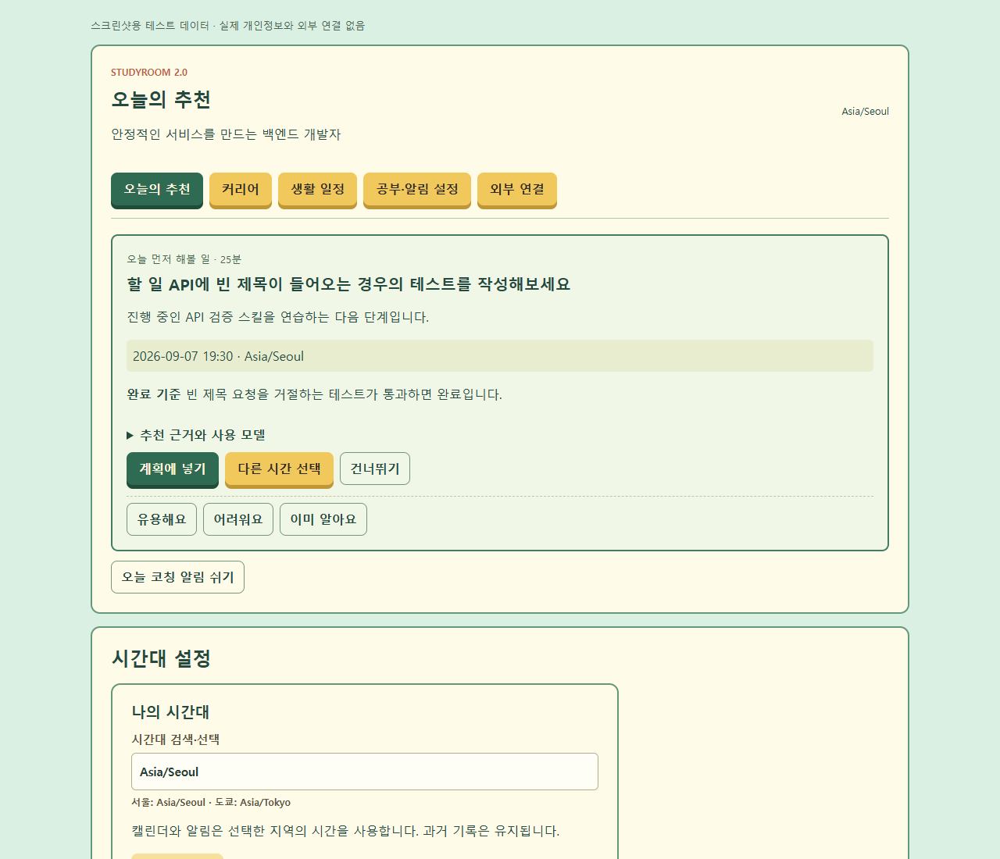

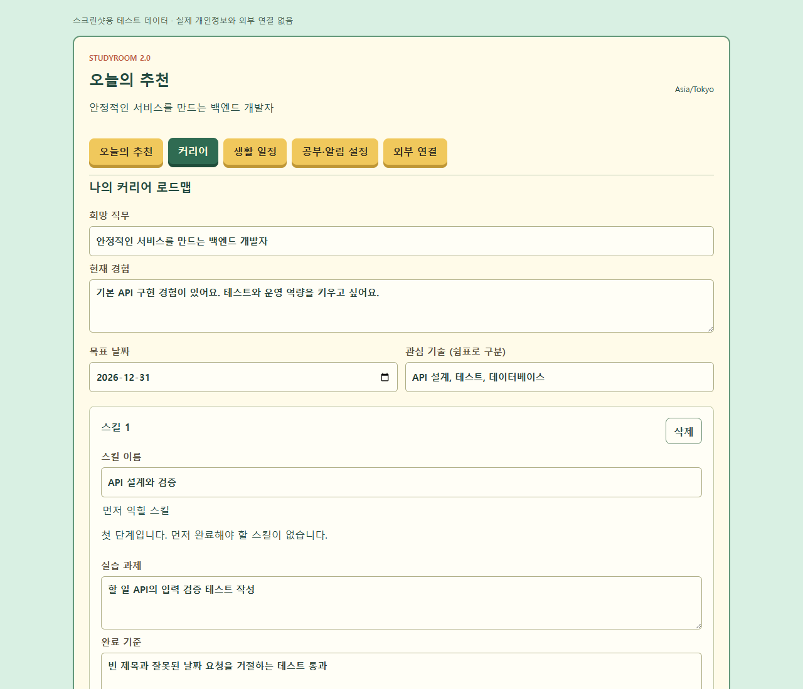

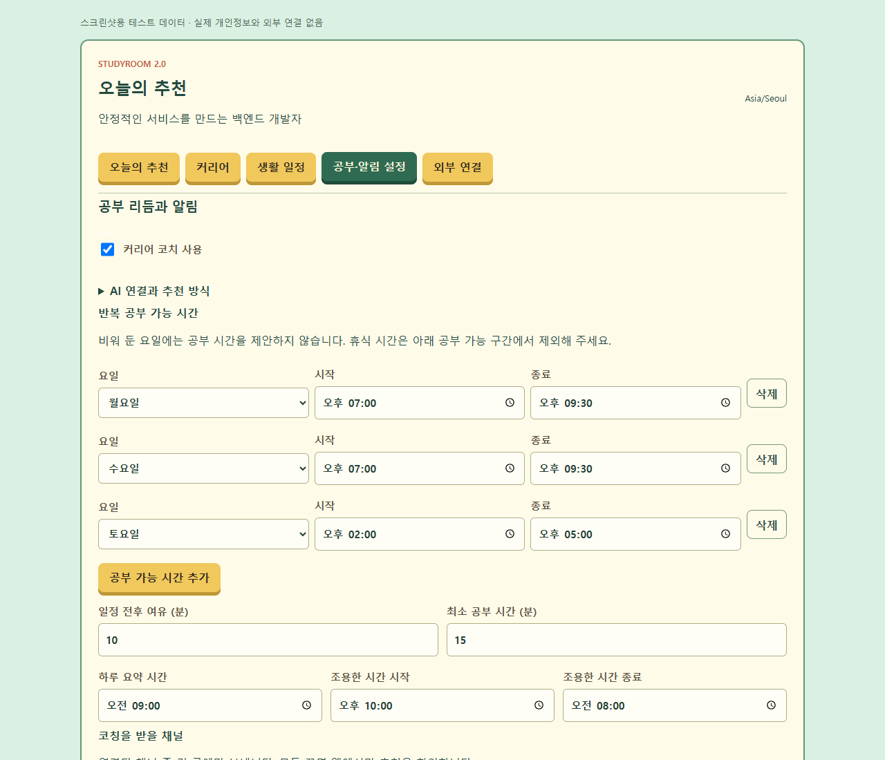

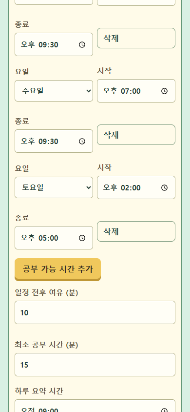

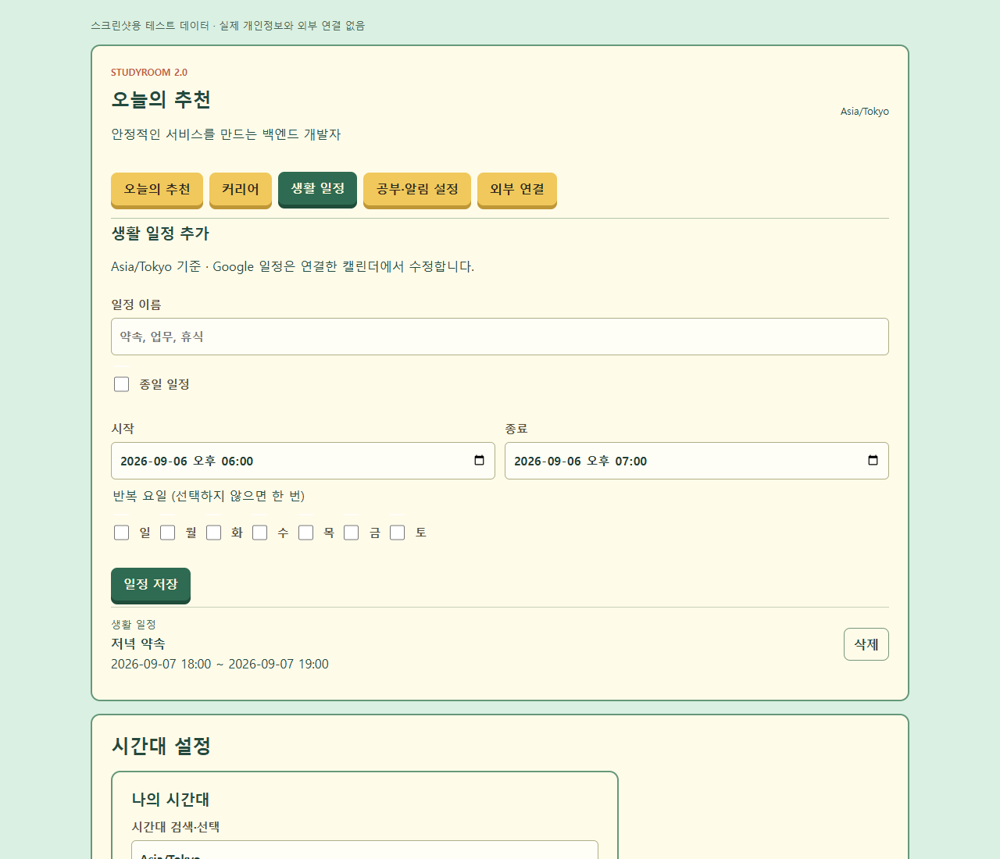
