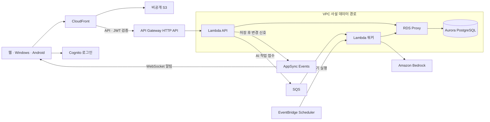
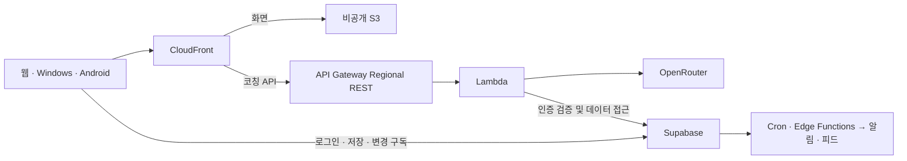

# 독서실 AWS 인프라 설계 — 2안 Aurora 완결형

**상태: 2안을 기본 목표로 선택 · 독립 시험판 코드 작성 · AWS 미배포.** [공식 아이콘 구성도(HTML)](./aws-architecture-review.html)는 내려받아 브라우저에서 열 수 있습니다. 현재 운영은 [기존 인프라 문서](../infrastructure-architecture.md)를 따릅니다. 이 설계 결정은 AWS 리소스 생성, 운영 전환 또는 기존 데이터 이전의 승인이 아닙니다.

## 기본 설계와 비용 대안

**2안이 기본입니다.** 인증·기록·동기화·AI를 AWS 서비스에 두고 동일한 CDK 배포 경로로 관리합니다. 비용 효율성이 더 중요해지는 경우에는 기존 Supabase·OpenRouter를 유지하는 [부록 A의 1안](#cost-alternative)으로도 구성할 수 있습니다. 아래 금액은 2026-11-07 기준의 예시이며, 운영 예산 승인 전에 실제 사용량과 요율을 다시 확인합니다.

| | 구성도 1 · 혼합형 | 구성도 2 · Aurora 완결형 |
|---|---|---|
| 바뀌는 것 | Vercel의 웹·코칭 API를 AWS에서 제공 | 웹·코칭뿐 아니라 로그인·DB·동기화·정기 작업을 AWS로 이전 |
| 유지하는 것 | Supabase Auth·PostgreSQL·Realtime·Cron/Edge, OpenRouter | 기존 학습 데이터와 기능 요구사항. Google·Slack·RSS 등 외부 연동은 기능을 쓰는 한 유지 |
| 월 예상 비용 | **AWS $2.03** + Supabase·OpenRouter 실사용료. Supabase Pro 기본·OpenRouter 무료 예시 **$27.03** | **$263.37**: 서울, Aurora Writer/Reader·Proxy, NAT 2개 예시 |
| 맞는 상황 | 기록 보존, 작은 운영비, 빠른 AWS 시험 | 외부 데이터·AI 플랫폼 제거 또는 AWS 중심 복구·권한 관리가 필수 |

## 기본 구성도 · 2안 Aurora 완결형

- **왜 이 구성인가:** Cognito가 로그인, Aurora가 기록, AppSync가 갱신 신호, EventBridge Scheduler가 정기 실행을 맡습니다. HTTP API는 통합 상한이 30초이므로 길어질 수 있는 AI 요청은 `202`로 접수한 뒤 SQS·Lambda가 Bedrock에서 처리하고 앱이 결과를 조회합니다. IAM·Secrets Manager·CloudWatch는 자원 권한·비밀값·운영 지표를 맡습니다. RDS Proxy는 연결 재사용 통로이며, RDS DB를 별도로 두는 안이 아닙니다.
- **AppSync의 역할:** PC에서 공부 시작 → Lambda가 Aurora에 저장 → AppSync가 권한 있는 화면에 변경 신호 전달 → 휴대폰이 인증된 API로 최신 상태 조회. AppSync에는 학습 원문이나 카메라 영상을 싣지 않습니다. 신호가 누락되면 재연결·화면 복귀·열린 화면의 주기적 보조 조회로 최신 상태를 확인합니다. 1안에서는 Supabase Realtime이 변경을 알립니다.
- **제약:** 기존 사용자 UUID·출석 규칙·팀 권한·DB 정책과 정기 작업을 이식해야 합니다. 토큰 검증만으로 팀 접근을 허용하지 않습니다. 팀 구독과 조회를 각각 검증하고, 기존 앱 로그인 복귀·재연결·백업 복원을 시험합니다.

## CDK 한 명령 배포의 범위

- **사전 준비:** 배포 대상 AWS 계정·리전과 자격 증명을 정하고 [CDK bootstrap](https://docs.aws.amazon.com/cdk/v2/guide/bootstrapping-env.html)을 한 번 실행합니다. 선택한 Bedrock 모델의 리전 가용성·호출 권한, AWS 한도와 월 예산을 확인합니다.
- **한 명령의 범위:** [독립 AWS 시험판 실행 가이드](../../infra/aws-native-pilot/README.md)에 따라 스택 배포 → 스키마 초기화 → 웹 설정 적용 → 두 시험 계정의 Cognito 토큰·합성 기록·상태 갱신·Bedrock 호출을 확인하도록 작성했습니다. 브라우저의 실제 관리형 로그인은 별도 수용 항목입니다. AWS에 배포하거나 실제 Bedrock을 호출하지 않았습니다.
- **경계:** [기존 CDK](../../infra/aws-cdk/README.md)는 정적 호스팅과 Supabase 예약 작업 호출을 위한 MVP입니다. 새 시험판은 별도 앱과 스택이며, [CDK](https://docs.aws.amazon.com/cdk/v2/guide/deploy.html)가 현재 앱의 Supabase 호출을 자동으로 바꾸지는 않습니다. 기존 계정·학습 기록 이전, 소셜 로그인 외부 설정, 기존 앱의 주소 변경과 운영 전환은 포함하지 않습니다.

## 평가와 의사결정

| 기준 | 1안 · 혼합형 | 2안 · Aurora 완결형 | 리뷰에서 확인할 것 |
|---|---|---|---|
| 비용 | 소규모 고정비가 낮음. Supabase 플랜·외부 AI 한도가 변수 | Writer/Reader·Proxy·NAT 고정비가 큼. ACU가 늘면 증가 | 월 상한, 실제 CDN 전송·DB I/O·AI 토큰·ACU |
| 운영 | 기존 규칙과 작업 재사용. 장애 추적은 공급자별로 분산 | AWS 권한·모니터링에 집중. 큐·구독·네트워크·복구를 직접 운영 | 알람 담당, 공급자별 장애 대응, 정기 작업 재시도 |
| 성능 | 코칭이 Supabase·OpenRouter 왕복에 의존. 기존 실시간 경로 유지 | 업무 API·DB를 같은 리전에 둘 수 있지만 Proxy·큐·추가 조회 비용도 생김 | 화면 로딩, 일반 API p95, PC→모바일 상태 지연 p95, AI 접수→완료 |
| 가용성·복구 | 기존 공급자 백업·복구 조건에 의존. 기존 Vercel을 둔 채 시험하기 쉬움 | Aurora의 다른 AZ Reader로 장애 전환 가능. 리전 장애·앱 전체 무중단을 보장하지 않음 | RPO/RTO, DB 장애 전환·시점 복원, 전환 후 쓰기의 되돌리기 |
| 보안·이전 | 현재 RLS와 계정 경계를 유지. 앱의 새 주소 신뢰 검증 필요 | DB 사설 접근·IAM 모델 권한을 통제. RLS 이식·계정 매핑·구독 권한은 새 위험 | 타 계정/팀 데이터 차단, 비밀·로그 취급, 기존 ID·기록 정합성 |

성능과 복구는 **설계상 차이이며 실측값이 아닙니다.** AWS 시험은 합성 데이터부터 시작합니다. 완결형을 선택하려면 외부 플랫폼 제거 필요성, 허용 월비용, 피크 지연, 허용 데이터 손실과 복구 시간이 먼저 합의되어야 합니다.

## 월 비용 계산

2026-11-07 기준, 서울 `ap-northeast-2`, 730시간, USD 세전. 월 활성 30명, 정적 요청 10만·전송 100 GB, S3 10 GB, 일반 업무 API 10만, AI 1,000회(입력 2,000·출력 500토큰/회), AppSync 50만 작업·12만 연결 분, 로그 수집/저장 각 1 GB를 가정했습니다. 실제 계정 청구액이나 보장 견적은 아닙니다.

| 항목 | 1안 계산 | 2안 계산 |
|---|---|---|
| CloudFront | 공용 잔여 무료 한도 내 → $0 | 동일 |
| S3 | `10×0.025 + 100000×0.00000035 + 1000×0.0000045` → $0.28950 | 동일 |
| API Gateway | REST `1000×0.0000035` → $0.00350 | HTTP `100000×0.00000123` → $0.12300 |
| Lambda x86 | `1000×0.5×5×0.0000166667 + 1000×0.0000002` → $0.04187 | `(120000×0.5×0.2 + 1000×0.5×5)×0.0000166667 + 121000×0.0000002` → $0.26587 |
| Secrets Manager | `1×0.40 + 1000×0.000005` → $0.405 | `2×0.40 + 2000×0.000005` → $0.81 |
| CloudWatch | `1×0.76 + 1×0.0314 + 0.50` → $1.2914 (알람 $0.50 예산 포함) | 동일 |
| Aurora Standard | — | `(0.5+0.5)×730×0.20 + 10×0.12 + 1000000×0.00000024` → $147.44 |
| RDS Proxy | — | `(0.5+0.5)×730×0.025` → $18.25 |
| NAT + IPv4 | — | `2×730×(0.059+0.005) + 10×0.059` → $94.03 |
| AppSync Events | Supabase Realtime에 포함/초과분 별도 | `0.5×1.00 + 0.12×0.08` → $0.5096 |
| Cognito / SQS / Scheduler | — | 직접·소셜 로그인 무료 구간 가정 + 큐·스케줄 소량 예산 $0.20 |
| 모델 | OpenRouter 실제 사용료; 무료 모델·한도 내 $0 | Nova Micro 예시: `2×0.041 + 0.5×0.164` → $0.164 |
| Supabase | 실제 플랜·초과분: Free $0 / Pro 기본 $25 예시 | — |
| **합계** | **$2.03 + 외부 실사용료** | **$263.37** |

반올림 전 합산 후 표시했습니다. Aurora+Proxy+NAT 합계 **$259.72**가 2안의 비용 대부분입니다. 합산 평균 DB 용량이 **1 ACU 증가**하면 `730×(0.20+0.025) = $164.25`가 더해집니다. NAT 1개면 `730×(0.059+0.005) = $46.72`를 줄일 수 있지만 AZ 이중화가 달라지는 별도 구성입니다. RDS Proxy를 연결한 상태에서는 Aurora 자동 일시중지를 가정하지 않았습니다. Bedrock 모델은 서울 호출 단가 예시이며, Nova Micro의 지역 간 추론 경로·한국어 품질은 확정 전 확인합니다.

열린 화면의 보조 조회 주기는 2안에서 실측으로 정합니다. 예를 들어 연결 12만 분 전부에 현재의 15초 주기 조회를 그대로 적용하면 보조 조회만 약 `120000×60÷15 = 480000`건이므로, 위 10만 API 가정을 다시 잡아야 합니다.

**제외:** 신규 크레딧, 할인, 세금, 도메인/DNS, WAF, 별도 KMS 키, 이메일/SMS, 추가 백업·전송, 외부 구독 초과분, 시험 기간 중복 운영, 이전/운영 인건비. 상시 무료 구간은 계정의 잔여 한도를 전제로 합니다. 1안과 2안의 서비스 수준·복구 목표가 동일하다는 뜻이 아닙니다.

### 출처

- 요율: [AWS Price List](https://docs.aws.amazon.com/awsaccountbilling/latest/aboutv2/price-changes.html), [서울 Aurora/RDS 공개 가격표](https://pricing.us-east-1.amazonaws.com/offers/v1.0/aws/AmazonRDS/current/ap-northeast-2/index.json), [RDS Proxy](https://aws.amazon.com/rds/proxy/pricing/), [VPC](https://aws.amazon.com/vpc/pricing/), [CloudFront FAQ](https://aws.amazon.com/cloudfront/faqs/), [AppSync](https://aws.amazon.com/appsync/pricing/), [Cognito](https://aws.amazon.com/cognito/pricing/), [Bedrock](https://aws.amazon.com/bedrock/pricing/), [Supabase](https://supabase.com/pricing), [OpenRouter](https://openrouter.ai/pricing).
- 설계: [AppSync Events](https://docs.aws.amazon.com/appsync/latest/eventapi/event-api-concepts.html), [HTTP API 한도](https://docs.aws.amazon.com/apigateway/latest/developerguide/http-api-quotas.html), [Regional REST API 한도](https://docs.aws.amazon.com/apigateway/latest/developerguide/api-gateway-execution-service-limits-table.html), [Aurora 자동 일시중지](https://docs.aws.amazon.com/AmazonRDS/latest/AuroraUserGuide/aurora-serverless-v2-auto-pause.html), [Nova Micro 리전](https://docs.aws.amazon.com/bedrock/latest/userguide/model-card-amazon-nova-micro.html), [AWS 공식 아이콘](https://aws.amazon.com/architecture/icons/).
- 프로젝트 기준: [코칭 핸들러](../../api/study-coaching.mjs), [웹 배포 설정](../../vercel.json), [아키텍처 맵](../../memory-bank/architecture-map.md).

## 부록 A · 비용 효율을 우선할 때: 1안 혼합형

- **언제 선택하나:** 소규모 운영에서 월 고정비와 이전 부담을 줄여야 할 때입니다. AWS 비용 예시는 월 $2.03이며 Supabase·OpenRouter 사용료는 별도입니다. 기존 로그인·학습 기록·출석 정책은 Supabase에 둡니다.
- **IaC 경계:** AWS 리소스는 CDK로 재현할 수 있습니다. Supabase의 DB·인증·작업 설정과 OpenRouter의 키·모델 정책은 공급자별 도구나 설정 절차로 별도 관리해야 합니다. AWS CDK만으로 외부 서비스까지 같은 방식으로 생성·검증·복구하는 구성은 아닙니다.
- **제약:** 기존 코칭 핸들러의 상한은 50초입니다. 동기 응답을 유지하려면 Regional REST API 통합 시간 상향과 CloudFront 원본 대기 시간을 검증해야 합니다. 설치 앱의 신뢰 주소와 로그인 복귀 주소도 별도 확인합니다.
