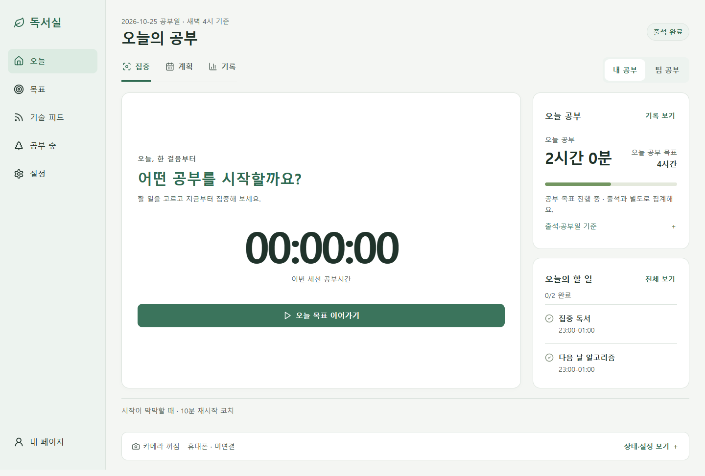
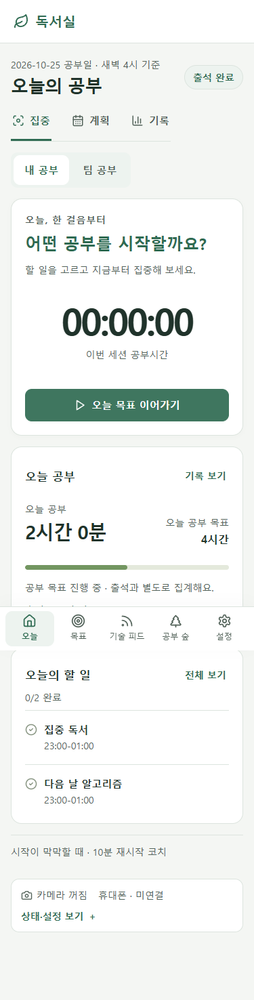

# HIG 공통 UI·Windows 로그인 조사/보완

- 작업 시작: 2026-10-26, 최종 인계는 2026-10-27. 기준052fede, feature `feat/hig-ui-auth`.
- 범위: 승인 목업의 정보 위계·공통 시각 토큰·반응형 탐색, Windows 이메일 오류 분류/Google 대기 안내. DB/학습·회복·계정 초기화나 정책 변경 없음.

## 실제 구현 화면

아래는 실제 제품 컴포넌트를 합성 계정/서버 데이터로 실행한 Chrome 화면이다. 본인 계정·실제 학습 기록·카메라 인증 수용 증거는 아니다.

## 변경 계약

- 기존 전역5목적지/내 페이지·개인 기본·팀 전환·계획·기록 유지. 800px 초과는 사이드 메뉴, 작은 창은 하단5메뉴/안전 여백이다.
- 세션의 타이머/공식 조작과 오늘의 총 공부/목표를 분리한다. 출석 완료와 공부/휴식 상태를 구분하고 숲은 전용 목적지로 남긴다.
- 기존 웹 토큰과 Android mobilePalette를 같은 흰 면/세이지/짙은 녹색으로 맞춘다. 카메라·회복·할 일·팀·RPC 소유자는 바꾸지 않는다.
- native sendCode는 fixed allowlist 오류만 전달한다. 이메일 한도1시간/일반 요청1분 재시도 대기를 재사용하며 공급자 raw error/개인정보는 노출하지 않는다. Google 브라우저 대기/5분 만료는 표시일 뿐 자동 인증·재시도·성공 판정이 아니다.

## 로그인 조사: 확인한 것과 미확인

- 설치0.1.0의 '코드 받기' 실패/일반 오류 화면을 읽었다. 코드가 공급자 분류까지 AUTH_FAILED로 숨기는 것을 확인했다.
- 운영 Supabase auth 로그12:00–14:20UTC 집계에429 over_email_send_rate_limit1건. 특정 사용자의 요청과 일대일 연결은 확인하지 않았으며 Google 정지의 원인으로 확대하지 않는다.
- 네이티브와 같은 Node 통신 계층에서 공개 auth/settings GET200, Google/email enabled. 인증 발송/로그인/학습 쓰기 없이 확인했다.
- 사용자는 새 Google 요청도 Chrome accounts.google.com 계정 선택 화면에서 로딩 정지함을 재확인했다. 앱 복귀/티켓 교환의 실제 성공은 아직 관찰하지 못했다. Chrome은 지원 대상이며 다른 브라우저 비교는 원인 분리 제안이지 필수 사용 조건이 아니다.
- 사용자 비밀번호/OTP/토큰·전체 인증 URL을 읽거나 문서화하지 않는다. 프로필/확장·쿠키·보안 설정을 초기화하지 않았고 SMTP/요금제/공급자 설정도 바꾸지 않았다.

## 검증

- 이메일 오류 분류 RED2·웹 쿨다운 RED1 → native/웹 집중 통과. 새 native 전체119/119, fixed-code IPC/실제 웹 안내·대기/만료 통과.
- UI RED(목표 그룹 부재), screenshot에서 발견한 height100% 메뉴 RED, 다크 환경 옛 배경 RED → 수정 후375/1440/다크 로그인/공통 목적지·44px·명도 대비 집중 통과.
- 독립 read-only 검토: Critical0/Important0/Minor0. 별도 Chrome375/801/1440×480에서 keyboard focus·Enter disclosure/메뉴 접근·기록 쓰기 없음 확인.
- 실제 Chrome 전체 최종1423/1423, 실패/생략/취소0,342271ms. 명령은 FEED_BROWSER_MODULE/EXECUTABLE을 지정한 `node --test --test-concurrency=2 packages/core/test/*.test.mjs apps/web/test/*.test.mjs server/ai/*.test.mjs scripts/*.test.mjs supabase/functions/_shared/*.test.mjs`이다. 근거 `output/hig-ui/accepted-chrome.log`.
- `ai.ps1 verify --project <root>`: Dune0위반·선언7명령 모두exit0. desktop check/test, npm test, Edge, mobile check, build, docs check. 근거 `output/hig-ui/verified-gates.log`.
- 실패 코호트 보존: 첫 전체1421 중3건은 옛 색상 literal2/모바일 팔레트1, 다음 전체는 native 초기 로그인 옛 색상/문구1건. 공유 의미 색 계약과 팔레트/문구를 수정한 뒤 최종 전체를 다시 실행했다. 검증용 전환중 색상 검사를 약화하지 않았다.
- 첫 Electron 실행은14/16, final-fixes2개가 설정된 바이너리 override를 무시해 launch 전 실패했다. 같은2개 단독으로도 재현, runner와 같은 환경 변수 우선 경로로 검사 설정만 수정했다. 최종 실제 Electron16/16·실패/생략/취소0,403226ms. 숨김360199ms 동안 영상+7203·성공ACK+360, 오류/timeout/pending0·같은 프로세스/문서/트랙live. 이는 합성 카메라/local IPC이고 실제 착석·본인 인증 수용은 아니다. 근거 `output/hig-ui/accepted-electron.log`.
- 제한: 인위적으로 모든 텍스트의 계산 fontSize를2배로 고정하는375px probe의 nowrap 타이머 넘침은 기존 제한이다(HEAD513px→현재424px). 실제 Chrome/Windows 페이지 확대 수용으로 표현하지 않는다. 실제 본인 인증/물리 웹캠/Android 신규 APK는 별도다.

## Windows 설치 파일

- `apps/desktop/dist/StudyRoom-Setup-0.1.1-x64.exe`,123053969bytes.
- SHA256 `0e62c3efc530c74b8ae625743151d2ea70f5f8d49b1645cd12840b0f9aecbacb`.
- ASAR529항목·금지0, main/preload/auth/runtime 소스 byte 일치. 공개 설정3키만 포함. NotSigned, 보안 경고 우회·인증서 구매 없음.
- appId/package name/실행 파일/프로필 `%APPDATA%/@study-room/desktop` 유지. 이전 문서의 추측 경로 부재는 실제 userData 부재 증거가 아니며 이관/삭제하지 않는다.
- 사용자 무삭제 덮어설치 승인 후 모든 gate를 확정하고 같은 `C:/jini-dev/apps/study-room-desktop`에 설치exit0. 설치asar/후보 byte hash 일치·기존 프로필 존재 유지. 앱 재실행/실제 인증은 웹 배포 후 확인하며 인증 입력은 사용자 직접 수행한다. 새 APK는 빌드/게시하지 않았으며 Android0.2.4/code7은 유지한다.

## 출시

- 아직 feature commit/push/production dispatch 전. 기존 `vercel-production.yml`의 검증된 feature ref 배포 경로를 사용한다.
- Vercel project/team/production alias와 GitHub repository/workflow를 확인했다. 기본 브랜치 직접 push·PR/merge·공개 Windows Release는 하지 않는다.
- 코드가 통과한 뒤 exactSHA·Actions success·Vercel READY·공개 alias/정적 자산200을 확인해 이 구역을 갱신한다. 기존 학습 기록 rollback/DB 변경 없음.
